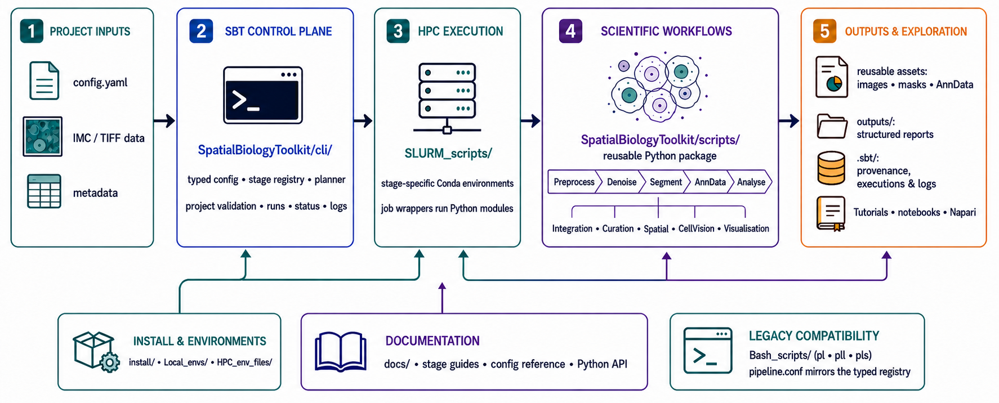

<p align="center">
  <a href="https://imcanalysis.readthedocs.io/en/latest/">
    
  </a>
</p>

<p align="center">
  A config-driven toolkit for imaging mass cytometry and spatial-biology analysis.
</p>

<p align="center">
  <a href="https://imcanalysis.readthedocs.io/en/latest/">Documentation</a> ·
  <a href="https://imcanalysis.readthedocs.io/en/latest/browser_tools/index.html">Browser tools</a> ·
  <a href="https://imcanalysis.readthedocs.io/en/latest/stages/index.html">Scientific guides</a> ·
  <a href="https://imcanalysis.readthedocs.io/en/latest/pipeline/cli.html"><code>sbt</code> CLI</a> ·
  <a href="https://imcanalysis.readthedocs.io/en/latest/tutorials/index.html">Tutorials</a>
</p>

> [!IMPORTANT]
> This project is actively developed and provided as-is. Bug reports,
> questions, and suggestions are welcome through GitHub Issues.

## What is SpatialBiologyToolkit?

SpatialBiologyToolkit (repository name: `imcanalysis`) analyses imaging mass
cytometry and other spatial-biology data. It combines a reusable Python
package with typed configuration, a project-aware `sbt` command-line interface,
SLURM pipeline stages, structured reports, browser-based explorers, interactive
tools, tutorials, and biologist-oriented explanations of the science behind
each processing stage.

The end-to-end, compute-heavy workflow is designed primarily for Linux HPC
systems running SLURM. Local environments support downstream analysis and
notebook work on Windows and macOS.



## Start here

- To explore local images, cells or acquisitions without installing the toolkit, open the [browser tools hub](https://spatialbiology.app/) and follow the [end-user guides](https://imcanalysis.readthedocs.io/en/latest/browser_tools/index.html).
- If the command line, Conda, or SLURM are new to you, read the [complete beginner's guide](https://imcanalysis.readthedocs.io/en/latest/getting_started/beginners.html).
- To understand what a stage does, why it is performed, and how to interpret its biological outputs, use the [scientific guides](https://imcanalysis.readthedocs.io/en/latest/stages/index.html).
- For the recommended HPC-first workflow, CSF3 beginners should use the [CSF3 setup](https://imcanalysis.readthedocs.io/en/latest/getting_started/hpc.html); experienced HPC users can start with the [`sbt` CLI guide](https://imcanalysis.readthedocs.io/en/latest/pipeline/cli.html), [pipeline workflow](https://imcanalysis.readthedocs.io/en/latest/pipeline/workflow.html), and [outputs/reporting guide](https://imcanalysis.readthedocs.io/en/latest/pipeline/reporting.html).
- For notebooks and interactive exploration, use the [local analysis setup](https://imcanalysis.readthedocs.io/en/latest/getting_started/local.html) and [tutorial index](https://imcanalysis.readthedocs.io/en/latest/tutorials/index.html).
- For exact stage and config fields, use the generated [SLURM stage reference](https://imcanalysis.readthedocs.io/en/latest/pipeline/stages/index.html) and [configuration reference](https://imcanalysis.readthedocs.io/en/latest/reference/configuration/index.html).

The usual pattern is to run compute-heavy, repeatable processing on HPC and
then copy the AnnData and selected images into a separate local analysis folder
for interactive work.

## Browser-based tools

Open these applications in a current desktop Chrome or Edge browser. Select
files on your computer, inspect the data, and download figures or review
settings. No Python, Node.js or SBT installation is needed to use the hosted
tools, and selected datasets are not uploaded to the application host.

| Tool | Use it for | Open | User guide |
| --- | --- | --- | --- |
| **Tissue Explorer** | Review analysed cells in `.h5ad` alongside TIFF images and masks; compare populations, annotate a review and export figures | [Open Tissue Explorer](https://explorer.spatialbiology.app/) | [Tissue Explorer guide](https://imcanalysis.readthedocs.io/en/latest/browser_tools/tissue_explorer.html) |
| **MCD Explorer** | Browse raw IMC acquisitions in an `.mcd` file, mix channels and inspect pixel counts before downstream analysis | [Open MCD Explorer](https://mcd.spatialbiology.app/) | [MCD Explorer guide](https://imcanalysis.readthedocs.io/en/latest/browser_tools/mcd_explorer.html) |
| **MERSCOPE Explorer** | Explore a SpatialData `.zarr` folder or ZIP with images, cell boundaries, transcript points and gene expression | [Open MERSCOPE Explorer](https://merscope.spatialbiology.app/) | [MERSCOPE Explorer guide](https://imcanalysis.readthedocs.io/en/latest/browser_tools/merscope_explorer.html) |

The dedicated [Browser-based tools documentation](https://imcanalysis.readthedocs.io/en/latest/browser_tools/index.html)
covers required inputs, first sessions, controls, exports, saved workspaces and
[troubleshooting](https://imcanalysis.readthedocs.io/en/latest/browser_tools/troubleshooting.html).
Tissue Explorer and MERSCOPE Explorer save review settings locally and can
export workspace JSON; MCD Explorer's settings and bookmarks last only for the
current session. Source datasets are not rewritten by the explorers.

## Choose your setup

| Use case | Platform | Starting point |
| --- | --- | --- |
| Reproducible end-to-end pipeline | Linux HPC with SLURM | [`sbt` CLI guide](https://imcanalysis.readthedocs.io/en/latest/pipeline/cli.html) ([CSF3 beginner setup](https://imcanalysis.readthedocs.io/en/latest/getting_started/hpc.html)) |
| Sequential pipeline commands | Linux server or EC2 without SLURM | [Linux/EC2 guide](docs/source/getting_started/ec2.md) and [editable runner](run_local.sh) |
| Local analysis and notebooks | Windows | [Local analysis setup](https://imcanalysis.readthedocs.io/en/latest/getting_started/local.html) |
| Browser-based image, cell and acquisition review | Desktop Chrome / Edge; no toolkit installation | [Choose a browser tool](https://imcanalysis.readthedocs.io/en/latest/browser_tools/index.html) |
| Local analysis and notebooks | Apple Silicon macOS | [Local analysis setup](https://imcanalysis.readthedocs.io/en/latest/getting_started/local.html) |

The portable macOS environment is tested on Apple Silicon with macOS 12 or
later and is not intended for Intel Macs. It intentionally omits CUDA, Windows
runtime packages, and several less-portable optional components; see the
[local analysis setup](https://imcanalysis.readthedocs.io/en/latest/getting_started/local.html)
for the current compatibility details.

Experienced Conda users can create a local environment from the repository
root. On Windows:

```bash
conda env create -f Local_envs/sbt_env.yml
```

On Apple Silicon macOS:

```bash
conda env create -f Local_envs/sbt_env_macos.yml
```

Then install the editable toolkit link without re-resolving the environment's
tested dependencies:

```bash
conda activate sbt
python -m pip install --no-deps -e .
```

Copy any notebooks you plan to edit out of `Tutorials/` and into your own
analysis directory before starting Jupyter.

## Pipeline at a glance

The lightweight `sbt` interface validates projects and configuration, plans
from each stage's direct asset requirements, submits the existing SLURM
wrappers, and records stage status, logs, outputs, and provenance. Conventional
lineage is warned about but does not block adopted downstream-only projects
whose required assets already exist. For example:

```bash
sbt project adopt --config config.yaml
sbt plan segmentation
sbt run segmentation --dry-run
sbt summary
```

Use `sbt project init` for a new project, or follow the complete
[`sbt` CLI guide](https://imcanalysis.readthedocs.io/en/latest/pipeline/cli.html)
before submitting a real run.

## Repository map

- `SpatialBiologyToolkit/`: reusable analysis package, typed configuration, CLI, scientific stages, and reporting code.
- `SpatialBiologyToolkit/cli/` and `SpatialBiologyToolkit/pipeline/`: lightweight project, planning, SLURM submission, status, and log control layers.
- `SpatialBiologyToolkit/reporting/`: typed stage manifests, report lifecycle, file inventories, Markdown reports, and project/stage indexes.
- `SpatialBiologyToolkit/scripts/`: config-driven pipeline entry points.
- `SLURM_scripts/`: registered job wrappers; `pipeline.conf` remains a legacy mirror of the Python stage registry.
- `Bash_scripts/`: legacy `pl`, `pll`, `pls`, plus `zipqc`, `cds`, and other HPC helpers.
- `Tutorials/`: current and archived Jupyter notebooks.
- `Local_envs/`: launcher plus Windows and portable macOS local environment definitions.
- `HPC_env_files/`: fixed pipeline environment definitions used by registered stages.
- `install/`: HPC launcher, shell integration, environment, and uninstall helpers.
- `docs/`: canonical Sphinx sources and generated reference tooling.
- `web_viewer/`, `mcd_viewer/`, and `spatialdata_viewer/`: application source and maintainer build/deployment notes for Tissue Explorer, MCD Explorer and MERSCOPE Explorer; end-user guides live in `docs/source/browser_tools/`.
- `tests/`: automated tests for the CLI, configuration, reporting, and scientific utilities.
- `External_and_old_code/`: unsupported historical/experimental material.

The README files that used to duplicate these topics now point into the
canonical Sphinx documentation, so changes should be made under `docs/source/`.

## Reporting issues

Please include the pipeline stage or notebook, environment definition, relevant
`config.yaml` overrides, and a short traceback or log excerpt. If you are unsure
whether something is a bug or a usage question, open an issue anyway.

For a browser tool, include its name and displayed version, website address,
browser/OS, input format and the steps leading to the problem. See the
[browser troubleshooting guide](https://imcanalysis.readthedocs.io/en/latest/browser_tools/troubleshooting.html#report-a-problem)
for useful details; do not attach private research datasets to a public issue.
