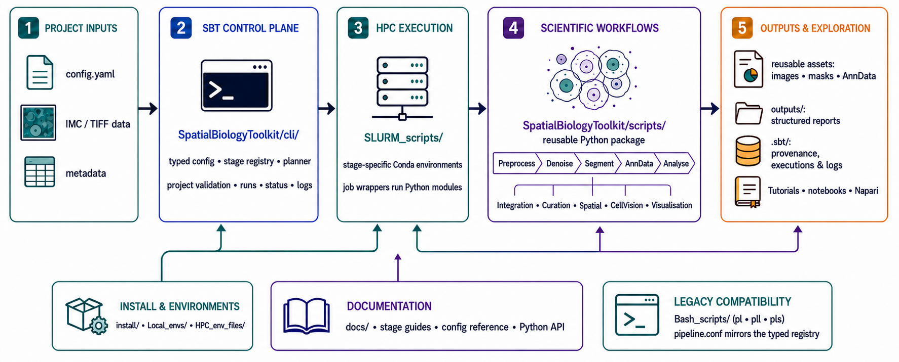

SpatialBiologyToolkit documentation
===================================

SpatialBiologyToolkit is a config-driven toolkit for imaging mass cytometry
and spatial-biology analysis. It supports a reproducible SLURM pipeline for
routine processing and Python tools for interactive and bespoke analysis.

Start with :doc:`getting_started/index` if this is your first visit. Pipeline
operators will usually want :doc:`pipeline/index`, while Python users can go
straight to :doc:`reference/index`. For a no-code, image-led workflow, use the
:doc:`NapariSBT guide <napari_sbt/index>`.

To explore local files without installing the toolkit, start with
:doc:`browser_tools/index`: IMC Explorer for analysed cells and images,
MCD Explorer for raw IMC acquisitions, and MERSCOPE Explorer for SpatialData.
Each hosted tool has an end-user guide covering data selection, review,
figures and saved settings.

.. toctree::
   :maxdepth: 1
   :caption: Contents

   Getting started <getting_started/index>
   Browser-based tools <browser_tools/index>
   🖼️ NapariSBT — no-code guide <napari_sbt/index>
   🔬 Scientific Guides <stages/index>
   ⚙️ Pipeline <pipeline/index>
   🛠️ Technical Guides <guides/index>
   🎓 Tutorials <tutorials/index>
   📚 Reference <reference/index>
   🗄️ Legacy & External <legacy/index>

Search and indices
------------------

* :ref:`genindex`
* :ref:`modindex`
* :ref:`search`
